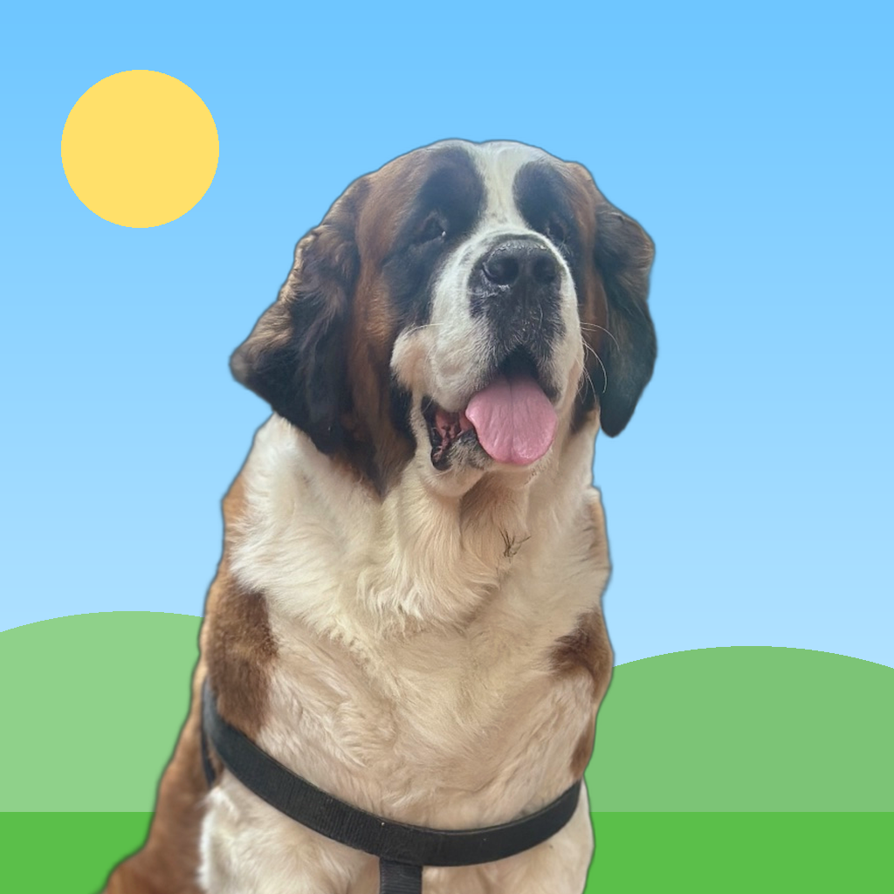
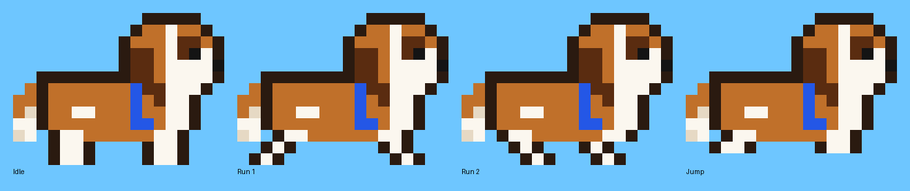

# Apna Sassy



An original side-scrolling platformer for iPhone (iOS 17 and later, built for iOS 27). You play
Apna Sassy, a Saint Bernard in a blue harness, trying to get home across four worlds. Run, jump, stomp critters, pop crates
for gems, and bounce off springs.



Apna Sassy is drawn from a photo of the real Sassy, and the app icon is made from another photo of her. All the characters, levels and pixel art are original. Every sprite and tile is drawn in code at
launch, so the app has no image files.

## Playing

- **Left thumb:** ◀ ▶ to run. **Right thumb:** jump. Hold jump to go higher, tap it for a hop.
- Land on **beetles** and **bats** to knock them out. Don't land on the purple **spikers**; jump
  over them.
- Hit **crates** from below to get a gem. **Springs** launch you about six tiles high.
- You have three hearts. Spikes and critters cost one; falling in a pit costs them all. You come
  back at the last **checkpoint flag** you touched.
- Reach the **leaf banner** to finish. Stars: one for finishing, one for every gem, one for
  beating the par time.
- A game controller or keyboard also works: arrows or WASD, plus Space or the A button.

| # | World | What's new |
|---|---|---|
| 1 | गंगा किनारोॅ (the Ganga bank) | Running, jumping, crates, beetles, a spring |
| 2 | खड़गपुर के गुफा (a cave in the Kharagpur hills) | Low ceilings, spike pits, spikers |
| 3 | बादलोॅ के सीढ़ी (steps in the clouds) | Floating islands, one-way platforms, springs |
| 4 | मुंगेर किला (Munger fort at dusk) | Everything at once |

## Language

All on-screen text is in Angika as spoken around Munger, Bihar, written in Devanagari:
"की बात छै! लेवल पार होय गेलै!" when you finish a level, "तनी दम धरोॅ" on the pause screen,
and "अपना सैसी घोॅर पहुँची गेलै!" at the end of the game. Every line lives in
`App/Strings.swift`, so wording can be changed in one place.

## Install on your iPhone

You need a Mac with Xcode.

```bash
brew install xcodegen
cd apna-sassy
xcodegen generate
open ApnaSassy.xcodeproj
```

In Xcode, pick your team under **Signing & Capabilities** (a free Apple ID works), change the
bundle ID from `com.example.ApnaSassy` to something unique, plug in your iPhone, and press Run.
The first time, approve the developer on the phone in Settings › General › VPN & Device
Management.

## How it's built

| Folder | What it is |
|---|---|
| `Sources/GameCore/` | The game itself in plain Swift: physics, collisions, enemies, scoring, and the level maps. No UI code. |
| `App/` | The iPhone app: a SpriteKit scene that draws the game, SwiftUI menus, HUD and touch controls, and saved progress |
| `Tests/GameCoreTests/` | Physics and rules tests, plus a bot that plays every level |

Levels are ASCII maps in `Sources/GameCore/Levels.swift`. The legend is in `Level.swift`: `#`
ground, `C` crate, `=` platform, `^` spikes, `S` spring, `*` gem, `e`/`b`/`s` enemies, `K`
checkpoint, `P` start, `G` goal. To add a level, add a `LevelDefinition` to `Levels.all`.

The engine runs at a fixed 120 steps a second. Movement has coyote time and jump buffering, so
jumps feel fair on a touch screen.

## Tests

```bash
cd apna-sassy && swift test
```

Besides unit tests for jumping, walls, crates, stomping, spikes, springs, platforms and
checkpoints, a test bot holds right and jumps at walls, gaps, spikes and enemies. It must finish
all four levels without dying, which proves every level can be beaten with the real physics.
